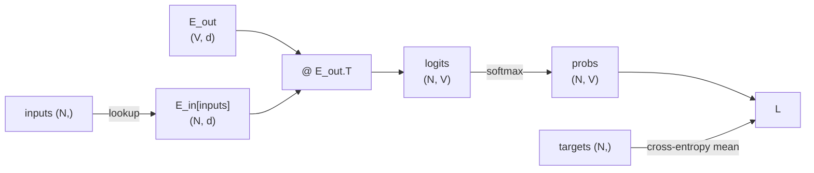
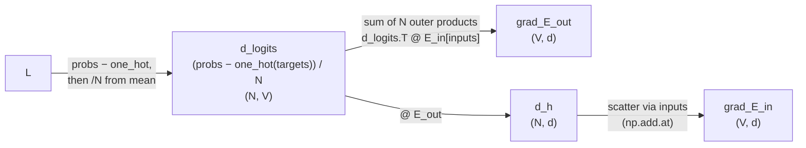
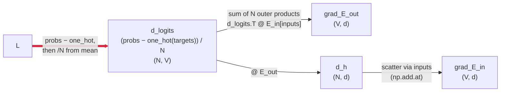
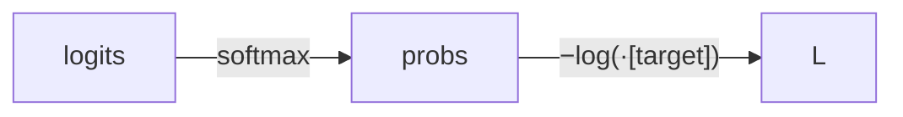
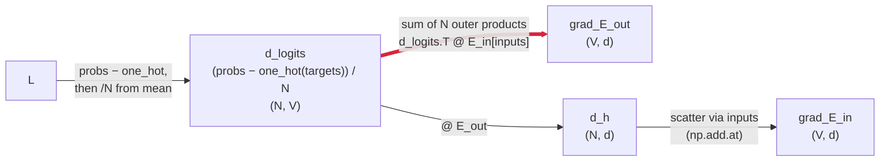
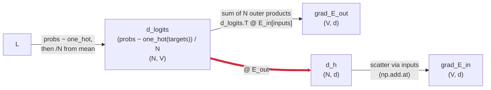
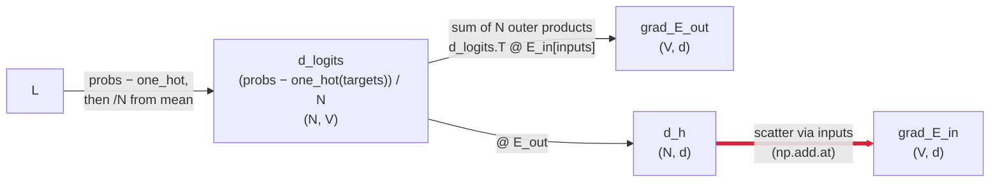

When I started writing the flash attention series, embeddings were on my "I get it intuitively" list. A word becomes an N-dimensional vector, the geometry encodes meaning,
cats are near dogs and not near typewriters. That was enough to write the forward pass. For GPU code, embeddings are floats with shape and the kernel doesn't care what the floats mean.

After I shipped my poorly performing Triton kernel on Flash Attention's forwarding pass, I took a step back and tried to dig deeper into those embeddings beyond the surface level "intuitive understanding".

A few blog posts and some light readings in, it was pretty clear: They're trained. Not authored, not initialized from some clever scheme. The embedding matrix is
a parameter and gradient descent shapes it like any other weight. So I went looking for the simplest training loop I could find. A bigram next-token predictor.
Two embedding matrices, a dot product, softmax, cross-entropy, gradient descent. Five lines. I could read each line.

Until the backward pass. I could see the gradients being computed; I could not tell you why the math worked. Not "I haven't done calc 3 in a decade." (I took it in 2017)
More like "I've never actually understood backpropagation." The undergraduate version where you derive the chain rule for one neuron, sure. The version where you can stare
at five lines of NumPy and explain why those five lines train an embedding table, I did not have that.

I took a massive detour and spent a few days burning a crap load of LLM tokens. Turns out, there's some quite beautiful math here behind those
massive embedding matrices.

---

**Contents**
- [The simplest training loop I could find](#simplest-loop)
- [Walking the backward graph](#backward-walk)
- [From L to d_logits: where the cancellation lives](#l-to-dlogits)
- [From d_logits to grad_E_out: matmul backward](#dlogits-to-gEout)
- [From d_logits to d_h: the mirror](#dlogits-to-dh)
- [Scatter-add for shared embeddings](#dh-to-gEin)
- [What I actually learned](#what-i-learned)

---

## The simplest training loop I could find {#simplest-loop}

The model is a bigram next-token predictor. Two embedding matrices, both shape `(V, d)`: `E_in` for the current token and `E_out` for the candidate next tokens. Forward pass: look up the current token's row in `E_in`, dot it against every row of `E_out` to get V scores, softmax for probabilities, cross-entropy against the actual next token.

The whole thing in one block, data prep and training loop together:

```python
import numpy as np

# ── Toy corpus ────────────────────────────────────────────────────
sentences = [
    "the cat sat on the mat",
    "the dog sat on the rug",
    "the cat chased the dog",
    "I saw the cat",
    "I love the dog",
    "a cat is small",
    "a dog is big",
]

# Build vocab and (current_token, next_token) pairs
tokens = " ".join(sentences).split()
vocab  = sorted(set(tokens))
w2i    = {w: i for i, w in enumerate(vocab)}

bigram_pairs = []
for s in sentences:
    toks = s.split()
    for t in range(len(toks) - 1):
        bigram_pairs.append((w2i[toks[t]], w2i[toks[t + 1]]))
bigram_pairs = np.array(bigram_pairs)

V = len(vocab)            # vocab size
d = 2                     # embedding dim (2 so we can plot later)
N = len(bigram_pairs)     # number of training examples per batch

# ── Embedding tables, initialized small and random ────────────────
np.random.seed(42)
E_in  = np.random.randn(V, d) * 0.3   # input/center-word embeddings
E_out = np.random.randn(V, d) * 0.3   # output/candidate-word embeddings

lr = 1.0

# ── Train ─────────────────────────────────────────────────────────
for epoch in range(1000):
    inputs  = bigram_pairs[:, 0]   # (N,) current tokens
    targets = bigram_pairs[:, 1]   # (N,) next tokens

    # Forward
    logits  = E_in[inputs] @ E_out.T                          # (N, V)
    logits -= logits.max(axis=1, keepdims=True)               # softmax stability
    probs   = np.exp(logits) / np.exp(logits).sum(axis=1, keepdims=True)
    loss    = -np.mean(np.log(probs[np.arange(N), targets] + 1e-10))

    # Backward
    d_logits = probs.copy()
    d_logits[np.arange(N), targets] -= 1
    d_logits /= N

    grad_E_out = d_logits.T @ E_in[inputs]
    grad_E_in  = np.zeros_like(E_in)
    np.add.at(grad_E_in, inputs, d_logits @ E_out)

    # Update
    E_in  -= lr * grad_E_in
    E_out -= lr * grad_E_out
```

Two lookup tables, a dot product, softmax, cross-entropy, gradient descent. No attention, no FFN, no positional encoding. The forward is straightforward; the four lines under
`# Backward` are where I had to start over from scratch. The rest of the post is the walk back from `L` through those four lines, edge by edge. Nobody uses bigram models in 2026,
but this is the cleanest place I could find to ask what it actually means to train an embedding.

One misconception I want to flag up front, because it bit me. I'd assumed `E_out` was the "predictor" matrix and `E_in` was the "embedding" matrix. They're not. They're both
embedding matrices. The predictor isn't either of them. It's the dot product between them. Each token gets two rows in two tables, one for when it's the input and one for when
it's a candidate output, and training shapes both. 


## Walking the backward graph {#backward-walk}

The hard part wasn't the math on any single line. It was that code shows the operations in execution order, not in dependency order. The fix that finally worked was drawing the
forward graph, drawing the backward graph beside it, and walking the backward one edge at a time. The chain rule is "multiply by the local Jacobian as you cross each
edge," and every edge corresponds to a line from the training loop.

Formally: if a scalar $L$ depends on intermediates $y_1, \ldots, y_n$ that each depend on $x$, then

$$\frac{\partial L}{\partial x} \;=\; \sum_i \frac{\partial L}{\partial y_i} \cdot \frac{\partial y_i}{\partial x}$$

Find every path from $x$ to $L$ in the forward graph, multiply the local sensitivities along each path, and sum across paths.

So for the forward pass, the graph looks like this:



Backward is the same graph in reverse, with each edge replaced by the local Jacobian for that op:



Four edges, walked rightmost-first:

1. L → d_logits. Softmax and cross-entropy collapse to `probs − one_hot(target)`, with `/N` from the mean riding through.
2. d_logits → grad_E_out. Matmul backward, which turns out to be a sum of outer products.
3. d_logits → d_h. The mirror, an intermediate gradient with no name in the original code.
4. d_h → grad_E_in. Scatter-add, because input tokens can repeat.

One section per edge.

---

## From `L` to `d_logits`: where the cancellation lives {#l-to-dlogits}



Loss is $L = -\log p_{\text{target}}$, probabilities come from softmax over logits, and the chain we need to walk is



The chain rule for it:

$$\frac{\partial L}{\partial \ell_j} \;=\; \sum_i \frac{\partial L}{\partial p_i} \cdot \frac{\partial p_i}{\partial \ell_j}$$

Softmax has a vector in and a vector out, so the second factor is a Jacobian matrix, not a scalar derivative.

What we're computing here is a vector. The scalar loss sits at the bottom, but we want one partial derivative per logit. That's `d_logits`, shape $(V,)$ for a single example.

The sum on the right has $V$ terms because every probability depends on every logit. The softmax denominator couples them all, so $\ell_j$ has $V$ paths to $L$, one through each $p_i$. Sum the contributions of all of them.

The chain has two steps, $L \leftarrow \text{probs}$ and $\text{probs} \leftarrow \text{logits}$, and I'm walking both as one leg here because the useful simplification only appears
after multiplying them. One side is a vector of zeros except at one entry. The other is a $V \times V$ Jacobian.

Start with $\partial L / \partial p_i$. My first guess was that every entry was $-1/p_i$, because that's what the derivative of $-\log$ looks like. That is wrong.

Look back at the loss line:

```python
loss = -np.mean(np.log(probs[np.arange(N), targets] + 1e-10))
```

Only `probs[..., targets]` enters $L$. Every other entry of `probs` is computed by the forward pass but never read by the loss, so its partial derivative is zero:

$$\frac{\partial L}{\partial p_i} \;=\; \begin{cases} -\,1 / p_{\text{target}} & \text{if } i = \text{target} \\ 0 & \text{otherwise} \end{cases}$$

A vector of zeros except at one position. $L$ is a function of exactly one number, the one at the target index; the rest of $p$ might as well not exist. So in the chain-rule sum, $V - 1$ terms are already dead before the softmax Jacobian enters.

The second piece, the softmax Jacobian, has the diagonal / off-diagonal structure

$$J_{ij} \;=\; \frac{\partial p_i}{\partial \ell_j} \;=\; p_i \,(\delta_{ij} - p_j)$$

where $\delta_{ij}$ is the Kronecker delta,

$$\delta_{ij} \;=\; \begin{cases} 1 & \text{if } i = j \\ 0 & \text{if } i \neq j \end{cases}$$

I saw this written in a few softmax derivations before I knew what it meant, and it looked more complicated than it is. It's an `if` statement: if $i = j$ output 1, else output 0. The Jacobian has different formulas on the diagonal and off-diagonal, and "branch on whether the indices match" is exactly what `if` does. $\delta_{ij}$ is the math-notation version.

I'm not going to do the full $J_{ij}$ derivation in the body. It's a quotient-rule grind that doesn't add insight. Click to expand.

<details markdown="1">
<summary>Softmax Jacobian derivation (click to expand)</summary>

Author note: turns out this was actually pretty straightforward after I came back to it the next day with a bit more caffeine.

Softmax is $p_i = e^{\ell_i} / \sum_k e^{\ell_k}$. Differentiate with the quotient rule: if $f = g/h$, then $f' = (g'h - gh') / h^2$. Set $g = e^{\ell_i}$ and $h = \sum_k e^{\ell_k}$. Two cases for $\partial p_i / \partial \ell_j$, depending on whether the index we're differentiating by is the one in the numerator.

**Case 1: $i = j$.** Both $g$ and $h$ depend on $\ell_i$.

$$\frac{\partial g}{\partial \ell_i} = e^{\ell_i}, \qquad \frac{\partial h}{\partial \ell_i} = e^{\ell_i}$$

(Only the $\ell_i$ term in $\sum_k e^{\ell_k}$ survives.) Plug into the quotient rule:

$$\frac{\partial p_i}{\partial \ell_i} \;=\; \frac{e^{\ell_i} \cdot \sum_k e^{\ell_k} \;-\; e^{\ell_i} \cdot e^{\ell_i}}{\left(\sum_k e^{\ell_k}\right)^2}$$

Factor $e^{\ell_i}$ out of the numerator:

$$=\; \frac{e^{\ell_i} \left(\sum_k e^{\ell_k} - e^{\ell_i}\right)}{\left(\sum_k e^{\ell_k}\right)^2}$$

Split into two fractions, each of which is a softmax probability:

$$=\; \frac{e^{\ell_i}}{\sum_k e^{\ell_k}} \cdot \frac{\sum_k e^{\ell_k} - e^{\ell_i}}{\sum_k e^{\ell_k}} \;=\; p_i \cdot (1 - p_i)$$

The squared denominator looked ominous when I started; once you split the fraction, each piece is itself a softmax probability, and the square dissolves. That was the small surprise of the derivation for me.

**Case 2: $i \neq j$.** The numerator $e^{\ell_i}$ doesn't contain $\ell_j$ at all, so $\partial g / \partial \ell_j = 0$. The first term of the quotient rule vanishes:

$$\frac{\partial p_i}{\partial \ell_j} \;=\; \frac{0 \cdot \sum_k e^{\ell_k} \;-\; e^{\ell_i} \cdot e^{\ell_j}}{\left(\sum_k e^{\ell_k}\right)^2} \;=\; -\,\frac{e^{\ell_i} \cdot e^{\ell_j}}{\left(\sum_k e^{\ell_k}\right)^2}$$

Split the same way:

$$=\; -\,\frac{e^{\ell_i}}{\sum_k e^{\ell_k}} \cdot \frac{e^{\ell_j}}{\sum_k e^{\ell_k}} \;=\; -\,p_i \cdot p_j$$

**Combine** with the Kronecker `if`:

$$J_{ij} \;=\; \frac{\partial p_i}{\partial \ell_j} \;=\; p_i \cdot (\delta_{ij} - p_j)$$

When $i = j$, $\delta_{ij} = 1$ and you get $p_i(1 - p_i)$. When $i \neq j$, $\delta_{ij} = 0$ and you get $-p_i p_j$. Two cases collapse into one formula.

</details>

What does $J_{ij}$ look like as an actual matrix? For a tiny vocab of 3 words with $\text{probs} = [p_0, p_1, p_2]$:

$$J \;=\; \begin{bmatrix} \dfrac{\partial p_0}{\partial \ell_0} & \dfrac{\partial p_0}{\partial \ell_1} & \dfrac{\partial p_0}{\partial \ell_2} \\[6pt] \dfrac{\partial p_1}{\partial \ell_0} & \dfrac{\partial p_1}{\partial \ell_1} & \dfrac{\partial p_1}{\partial \ell_2} \\[6pt] \dfrac{\partial p_2}{\partial \ell_0} & \dfrac{\partial p_2}{\partial \ell_1} & \dfrac{\partial p_2}{\partial \ell_2} \end{bmatrix} \;=\; \begin{bmatrix} p_0(1 - p_0) & -\,p_0 p_1 & -\,p_0 p_2 \\ -\,p_1 p_0 & p_1(1 - p_1) & -\,p_1 p_2 \\ -\,p_2 p_0 & -\,p_2 p_1 & p_2(1 - p_2) \end{bmatrix}$$

Read it column by column: column $j$ answers "if I nudge $\ell_j$ up, what happens to every output probability?" The diagonal entry goes up (that word gets more probable), every off-diagonal goes down (probability gets stolen from the others), and each column sums to zero because probability is conserved. The diagonals $p_i(1 - p_i)$ also looked familiar once I stared at them: that's the variance of a Bernoulli, maximized at $p_i = 0.5$.

Now compose them. The sum

$$\frac{\partial L}{\partial \ell_j} \;=\; \sum_i \frac{\partial L}{\partial p_i} \cdot J_{ij}$$

looks like it has $V$ terms, but $\partial L / \partial p_i$ is zero everywhere except $i = \text{target}$, so it collapses to a single term:

$$\frac{\partial L}{\partial \ell_j} \;=\; \frac{\partial L}{\partial p_{\text{target}}} \cdot J_{\text{target},\,j} \;=\; \left(-\,\frac{1}{p_{\text{target}}}\right) \cdot p_{\text{target}} \cdot (\delta_{\text{target},\,j} - p_j)$$

Now the cancellation is visible. The $-1/p_{\text{target}}$ from the log derivative cancels the $p_{\text{target}}$ that the softmax Jacobian puts in front of its target row. A $V \times V$ Jacobian and a $-1/p$ term turn into a subtraction:

$$\frac{\partial L}{\partial \ell_j} \;=\; -(\delta_{\text{target},\,j} - p_j) \;=\; p_j - \delta_{\text{target},\,j}$$

In vector form, that's `probs - one_hot(target)`, which is the line in the code:

```python
d_logits = probs.copy()
d_logits[np.arange(N), targets] -= 1
```

Subtract 1 only at the correct index; leave everything else as `probs[j]`. This was the first place where I went "oh, that's why this is the loss function." After the cancellation, "push the right answer up and the wrong answers down" is just an O(V) vector.

Holy shit, absolutely gorgeous.

Something else nagged me before I let myself move on. Why is the loss `-log(p)` at all, and not something simpler like `1 - p`? `1 - p` is the obvious "how wrong were we" measure. Probability 1 gives loss 0, probability 0 gives loss 1.

Two reasons for `-log`. One is maximum likelihood: logs turn a product of probabilities into a sum. The other is the penalty shape. With `1 - p`, $dL/dp = -1$, the same constant penalty no matter how confident the wrong answer was. With `-log(p)`, $dL/dp = -1/p$, which grows as $p$ approaches zero. A confidently wrong prediction should push harder than a mildly wrong one. The numbers make the gap obvious:

| $p_{\text{target}}$ | loss `1 - p` | grad `1 - p` | loss `-log p` | grad `-log p` |
|---:|---:|---:|---:|---:|
| 0.001 | 0.999 | −1 | 6.91  | **−1000** |
| 0.01  | 0.99  | −1 | 4.61  | **−100** |
| 0.1   | 0.9   | −1 | 2.30  | −10 |
| 0.5   | 0.5   | −1 | 0.69  | −2 |
| 0.9   | 0.1   | −1 | 0.105 | −1.11 |

`1 - p` gives every wrong answer the same gradient. `-log(p)` ramps the gradient by orders of magnitude when the model is confidently wrong, which is exactly where you want the strongest push. I'd assumed something more exotic was hiding in `-log`; for this training loop, that was most of the story.

The last detail on this edge is the `/N`. The loss is `np.mean(-log p)`, not `sum(-log p)`, and mean is `sum / N`, so the `1/N` rides along into `d_logits`. With `mean`, the gradient scale is less tied to batch size; with `sum`, doubling the batch doubles the gradient unless you compensate somewhere else.

---

## From `d_logits` to `grad_E_out`: matmul backward {#dlogits-to-gEout}



`grad_E_out = d_logits.T @ E_in[inputs]`. The gradient at the output embedding table, shape `(V, d)`, same as `E_out`. The question I couldn't answer: how does a matrix
multiplication produce a gradient? I'd seen `dA = dy @ B.T` in PyTorch tutorials a hundred times, treated it as a memorized rule, and never quite really understood why.

Anyway, forget the batch for a second; look at one example $k$. In the forward pass, its contribution to the logits is

```
logits[k] = E_in[inputs[k]] @ E_out.T          shape (V,)
```

which is `E_out` (a `(V, d)` matrix) times the input embedding vector (a `(d,)` vector), giving a length-$V$ row of logits. Each entry of `logits[k]` is the dot product of `E_in[inputs[k]]` with one row of `E_out`.

The gradient at `E_out` from this one example has to match `E_out`'s shape, `(V, d)`. Each entry $(i, j)$ is $\partial L / \partial (E_{\text{out}})_{ij}$.

For example $k$, the entry $(E_{\text{out}})_{ij}$ only appears in one logit. Write one out:

$$\text{logits}[k, i] \;=\; \sum_m (E_{\text{in}}[\text{inputs}_k])_m \cdot (E_{\text{out}})_{i,m} \;=\; E_{\text{in}}[\text{inputs}_k] \cdot E_{\text{out}}[i]$$

The right-hand form is the easier read: each output logit is its own dot product. The input row is shared across all of them. What changes from one logit to the next is which row of $E_{\text{out}}$ enters the dot product. Row $i$ produces logit $i$, no other row touches it.

So $(E_{\text{out}})_{ij}$, sitting in row $i$, only ever shows up in $\text{logits}[k, i]$. Within that dot product, it pairs with the $j$-th entry of the input row.

Pinning the derivation to a single example $k$ is the part I kept rushing past on first attempt. Without the per-example anchor I'd write chain-rule sums with $N$ terms when only one path actually contributes.

Chain-rule through the one logit:

$$\left.\frac{\partial L}{\partial (E_{\text{out}})_{ij}}\right|_{\text{example } k} \;=\; \underbrace{\frac{\partial L}{\partial\, \text{logits}[k, i]}}_{(d\_\text{logits})_{k,i}} \;\cdot\; \underbrace{\frac{\partial\, \text{logits}[k, i]}{\partial (E_{\text{out}})_{ij}}}_{(E_{\text{in}}[\text{inputs}_k])_j}$$

Both factors are labeled. The first is the gradient at logit $(k, i)$ that we computed in the previous section. The second is the coefficient on $(E_{\text{out}})_{ij}$ in the forward dot product, which is the matching component of the input vector.

Multiply them:

$$\left.\frac{\partial L}{\partial (E_{\text{out}})_{ij}}\right|_{\text{example } k} \;=\; (d\_\text{logits})_{k,i} \cdot (E_{\text{in}}[\text{inputs}_k])_j$$

That's an entry-by-entry definition of the outer product of two vectors (remember, `k` is fixed for this one example):

$$(d\_\text{logits})_k \in \mathbb{R}^{V}, \qquad E_{\text{in}}[\text{inputs}_k] \in \mathbb{R}^{d}, \qquad \text{outer product} \in \mathbb{R}^{V \times d}$$

So

$$\text{grad}\_E_{\text{out}}^{(k)} \;=\; \mathrm{outer}\!\left( (d\_\text{logits})_k,\; E_{\text{in}}[\text{inputs}_k] \right) \qquad \text{shape } (V, d)$$

One outer product per example. With N examples, you sum them. The stacked version is a matmul:

$$\begin{aligned}
\text{grad}\_\text{E}\_\text{out} \;&=\; \sum_{k=1}^{N} \mathrm{outer}\!\left( d\_\text{logits}_k,\; E_{\text{in}}[\text{inputs}_k] \right) \\[4pt]
&=\; d\_\text{logits}^{\top} \,@\, E_{\text{in}}[\text{inputs}]
\end{aligned}$$

I had a "WTF, did we just redefine matmul" moment looking at this. I'd always thought of matrix multiplication as a grid of dot products.
Now I had a sum of outer products,

Pick out entry $(i, j)$ of `d_logits.T @ E_in[inputs]`. By the textbook row-times-column definition:

$$\bigl(d\_\text{logits}^{\top} \,@\, E_{\text{in}}[\text{inputs}]\bigr)_{ij} \;=\; \sum_{k} (d\_\text{logits}^{\top})_{ik} \cdot (E_{\text{in}}[\text{inputs}])_{kj} \;=\; \sum_k (d\_\text{logits})_{k,i} \cdot (E_{\text{in}}[\text{inputs}_k])_j$$

That's the same entry as the sum-of-outer-products expression. Same indices, different grouping. I'd only ever been taught the row-times-column view; the outer-product view was the one I needed for the backward pass.

Tiny worked example, with `V = 2` and `d = 2` and two examples in the batch. Suppose

```
d_logits  =  [[1, 2],    # example 0's row
              [3, 4]]    # example 1's row
                        shape (N=2, V=2)

E_in[inputs] = [[5, 6],    # example 0's input embedding
                [7, 8]]    # example 1's input embedding
                          shape (N=2, d=2)
```

The two outer products are

```
outer([1, 2], [5, 6]) = [[5, 6],          example 0
                         [10, 12]]

outer([3, 4], [7, 8]) = [[21, 24],         example 1
                         [28, 32]]
```

Sum:

```
[[26, 30],
 [38, 44]]
```

And `d_logits.T @ E_in[inputs]` is

```
[[1, 3],   @  [[5, 6],   =  [[1*5 + 3*7, 1*6 + 3*8],   =  [[26, 30],
 [2, 4]]      [7, 8]]        [2*5 + 4*7, 2*6 + 4*8]]      [38, 44]]
```

Same matrix. I had to write this out by hand on paper before I believed it; I'd never done that exercise before.

---

## From `d_logits` to `d_h`: the mirror {#dlogits-to-dh}



The other matmul in the backward pass is `d_logits @ E_out`. The original code inlines it inside the scatter:

```python
np.add.at(grad_E_in, inputs, d_logits @ E_out)
```

I literally asked "what is `d_logits @ E_out`?" out loud at my screen the first time I read this line. It doesn't tell you what the intermediate is.
There's no name for it in the original code; it's just an `(N, d)` array that gets scattered into `grad_E_in`.

So I pulled it out and named it:

```python
d_h = d_logits @ E_out                # (N, d)
grad_E_in = np.zeros_like(E_in)
np.add.at(grad_E_in, inputs, d_h)
```

With the name in place, I can finally say what it is. Each example $k$ has a hidden vector $h_k = E_{\text{in}}[\text{inputs}_k]$, the looked-up input embedding. We never store $h_k$ explicitly because the forward writes it inline. But it exists as an intermediate, and gradient-wise it has a value. `d_h[k]` is "how should this example's input embedding move to reduce the loss." Shape `(N, d)`, one gradient vector per example. It's the gradient at the looked-up vectors, before we know which row of `E_in` to put it in.

The chain-rule derivation is the same outer-product machinery as before, applied to the other side of the matmul. Forward was `logits = h @ E_out.T`. The matmul-backward rule gives gradients on both sides:

```
forward        =  logits = h @ E_out.T  (h = E_in[inputs])
grad on E_out  =  d_logits.T @ h        (the previous section)
grad on h      =  d_logits @ E_out      (this section)
```

Same derivation, opposite axis. Instead of asking "what's the gradient at `E_out` from one example," ask "what's the gradient at $h_k$ from one example." The answer is `d_logits[k] @ E_out`, which stacked across examples is `d_logits @ E_out`.

Pulling `d_h` out changes nothing about the math, but it gives the intermediate a name I can point at: "this is the gradient at the input embeddings." Once that exists, the remaining step is getting those vectors into the right rows of `E_in`.

---

## Scatter-add for shared embeddings {#dh-to-gEin}



Why isn't this `grad_E_in[inputs] = d_h`?

Because `inputs` can have duplicates. In a batch built from "the cat sat on the mat", the token "the" appears twice. `inputs` would be something like `[the, cat, sat, on, the]`, and naive fancy assignment, with two rows that both want to write to `grad_E_in[the]`, silently keeps only one. NumPy doesn't error. It picks one and drops the other.

I found this out by writing the wrong version. `grad_E_in[inputs] = d_h` first, training loop ran, loss went down. Slower than it should have been, because half the gradient signal was getting silently dropped. The kind of bug that doesn't crash and doesn't print anything; it makes your model quietly worse.

The right operation is scatter-add: for each $k$, do `grad_E_in[inputs[k]] += d_h[k]`. Duplicates accumulate. `np.add.at(grad_E_in, inputs, d_h)` is the NumPy version.

The chain-rule reason this is correct, and not just a NumPy workaround: if a parameter is used $K$ times in the forward pass, it has $K$ paths to the loss, and the chain rule says sum the contributions from every path. `E_in[the]` was looked up twice, so it has two paths. Scatter-add is how that sum shows up for embedding tables.


---

## What I actually learned {#what-i-learned}

A few things, mostly opinions, in the order they hit me.

Softmax + cross-entropy is unreasonably clean. The whole messy Jacobian got reduced to `probs - one_hot(target)`, possibly divided by $N$.

The outer-product reading of matmul is really cool too. "Stack up the per-example outer products and sum them" makes the linear-layer backward feel less memorized than the transpose-placement rule. Claude swore that SVD and LoRA both use the same outer-product sum view, but I haven't chased either thread yet.

Embedding lookups are sparse-gradient operations, and this is where my intuition was most wrong going in. I'd assumed gradient flow was uniform: every parameter gets nudged on every step, the way it works in a fully-connected layer. For lookup tables, gradients live only where the batch actually looked. A batch with 5 distinct tokens out of a vocab of 50,000 produces 49,995 rows of zero gradient. `nn.Embedding` even has a `sparse=True` option. News to me while writing this.

A smaller one, but it took me a moment. In the training loop I care about here, backprop starts from a scalar loss $L$. Loss is the seed, $\partial L / \partial L = 1$, and that
single 1 is what propagates backward through the chain rule. If the output you cared about were a vector, you'd have to seed the backward pass with a vector too. The scalar loss
is why this loop has one backward pass with one starting point.

Anyway, unexpectedly cool learning from this detour. But yeah, I better get back to my embedding stuff now.
